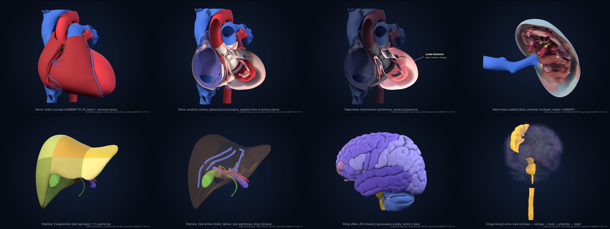

# Gabloty narządów: plan (serce, nerka, wątroba, mózg)

Stan: 2026-11-26, Wizualizator 3D, gałąź `claude/atlas-wizualizacja-3d-1dc29a`. **To jest wyłącznie plan.** Nie zmieniłem nic w `src/` ani w `blender/`. Kod powstanie dopiero po zgodzie użytkownika.

Podstawa decyzji:
- §7 `ATLAS_MODEL_ARCHITEKTONICZNY.md` z 2026-11-26: (a) atlas służy przede wszystkim licealistom, a HIIT jest przykładem; (b) gabloty narządów; (c) UI/UX prowadzi Reżyser;
- rozstrzygnięcia Dyrygenta 1–8 (`dyrygent/spory_UX_narzady.md`) i jego raport źródeł (`dyrygent/podstawy_oceny_narzadow.md`).

**Podział ról:** styl (paleta, podpisy, podświetlenie, tempo ruchu) należy do Reżysera i jest tu zapisany jako **parametry** (§2.8). Technika, budżety i wykonalność należą do mnie.

Klatki koncepcyjne leżą w `zrzuty/narzady/`, tablica zbiorcza to `narzady_tablica.jpg`. Są to rendery Blendera (EEVEE) **prawdziwych modeli HuBMAP**, ustawionych tak, jak pokazałaby je gablota, a nie zrzuty aplikacji. Klatki powstały przed rozstrzygnięciem „na etapie planu najlepiej bez Blendera”, w slocie `.render_slot_1`, który został zwolniony. Skrypt: `skrypty/concept_narzady.py`. Liczby zmierzone na modelach: `zrzuty/narzady/stats_modeli.json`.

## 0. W skrócie (dla użytkownika)

- **Gablota** to jeden narząd na środku ekranu, w tym samym studiu co widok 3D układów. Daje:
  - obrót i gotowe ujęcia (w tym przekrój);
  - nazwę części po najechaniu;
  - po kliknięciu panel „budowa i funkcja”;
  - tryb „Sprawdź się” („wskaż lewą komorę”);
  - przełącznik Spoczynek/Sprint, gdzie HIIT jest przykładem.
- **Film działania** to przycisk „Jak to działa”: sekwencja ujęć, którą można zatrzymywać krok po kroku.
  - serce: krążenie krwi i cykl pracy;
  - nerka: od krwi do moczu, z wejściem do nefronu;
  - wątroba: krew z jelit → komórki → żółć;
  - mózg: od decyzji „biegnę” w korze do rdzenia.
- **Wszystko w czasie rzeczywistym** w ≥ 50 FPS na zwykłej grafice (Intel UHD). Wypiekany film jest tylko rezerwą.
- **Telefon** dostaje gotowe obrazki ujęć z podpisami zamiast 3D, tak jak dziś plansze.
- **Geometria:** prawie wszystko jest w darmowym zbiorze HuBMAP (CC BY 4.0). Elementy mikroskopowe (nefron, zrazik, układ bodźcoprzewodzący) budujemy sami jako jawne schematy. Neuron może być prawdziwą rekonstrukcją z NeuroMorpho (CC BY 4.0).
- **Teksty** mają źródło z cytatem (drugi agent) i czekają na fakty podręcznikowe (E1-K3).
- **Pierwsze jest serce jako wzór** (ok. 30–40 godzin pracy agentów razem z faktami). Potem nerka, wątroba i mózg. Razem ok. 110–150 godzin.

## 1. Wspólne dla czterech gablot

### 1.1 Źródła i licencje (sprawdzone na plikach)

| Narząd | Siatka makro | Licencja | Wnętrze w danych? | Co trzeba zbudować |
|---|---|---|---|---|
| Serce | HuBMAP `VH_M_Heart` (v1.2) + `VH_M_Blood_Vasculature_Heart` | CC BY 4.0 | **Tak.** 2 przedsionki, 2 komory i przegroda to zamknięte bryły (sprawdzone w Blenderze: 0 krawędzi niezamkniętych). Są też 4 zastawki i 5 mięśni brodawkowatych | układ bodźcoprzewodzący (schemat). Zastawki są **jedną siatką bez osobnych płatków**, więc ich ruch wymaga podziału (§3.3) |
| Nerka | HuBMAP `VH_M_Kidney_L` + naczynia nerkowe + `VH_M_Ureter_L` | CC BY 4.0 | **Częściowo.** Są: torebka, kora zewnętrzna, słupy, 9 piramid, 9 brodawek, wnęka. **Brak nefronu.** Słupy przeplatają się z korą, więc przekrój bez „zalania” to labirynt (klatka `nerka_1`) | nefron (schemat własny) |
| Wątroba | HuBMAP `VH_M_Liver` + naczynia, pęcherzyk, drogi żółciowe | CC BY 4.0 | **Tak, z poprawką do raportu Dyrygenta:** plik `VH_M_Liver.glb` **ma** 8 osobnych brył segmentowych (płat ogoniasty, 4 prawe, 2 lewe boczne, lewy przyśrodkowy górny i dolny, płat czworoboczny; klatka `watroba_1`). Ma też naczynia wewnątrzwątrobowe: żyłę wrotną z gałęziami i 3 żyły wątrobowe (`VH_M_Blood_Vasculature_Liver`). **Brak zrazika** | zrazik (schemat własny). BodyParts3D (CC BY 4.0) niepotrzebne, chyba że agent faktów nie dopasuje nazw HuBMAP do numeracji I–VIII |
| Mózg | HuBMAP `Allen_M_Brain` (283 węzły = 141 struktur × L/P) + `VH_M_Spinal_Cord` | **CC BY 4.0 dopiero od v1.3**, a lokalny plik jest w **v1.2** (`ATLAS_ASSETS.md`) | **Tak.** Zakręty, jądra, komory, móżdżek, pień. Płaty składa się z zakrętów: automat przypisał 281 z 283 obszarów | pobrać mózg v1.3+ (oficjalne repo, darmowe, pytanie 1 w §6); neuron z NeuroMorpho albo schemat |

Wszystkie gabloty to wyłącznie pliki HuBMAP, czyli BY, bez Z-Anatomy. Nie ma więc mieszania licencji. Jedyny element Z-Anatomy to lokalizator „gdzie w ciele”, i to jako osobny obrazek (§1.4). Bez NC: nerka, miedniczka i ucho Z-Anatomy pozostają zablokowane (`NC_BLOCKLIST`). Źródła NC do unikania: UMCG (układ bodźcoprzewodzący), Visible Heart Labs, iusmlib.

**Geometria własna (mikro) to schemat, a nie anatomia z pomiaru.**
- Budujemy ją jako rury i proste bryły według **kolejności i połączeń** podanych w faktach podręcznikowych, a nie z wymyślonych kształtów.
- Proporcje nie pochodzą z pomiaru. W UI stoi stała plakietka „schemat, bez skali”, a styl różni się od makro (§2.8).
- Wzorem do sprawdzenia kolejności mogą być ilustracje FTU z HRA 2D (CC BY 4.0, z podaniem atrybucji).
- Generatorów AI 3D nie używamy.
- Uploadów ze Sketchfab domyślnie nie używamy (rozstrzygnięcie 7).
- Uwaga: istnieje schemat zrazika na CC0 (OrganUI `liver-lobule.glb`, generator w repozytorium MIT z plikiem atrybucji). Może służyć jako porównanie, ale domyślnie budujemy własny.

### 1.2 Wydajność (dla każdej gabloty, Intel UHD, 1440×900)

| | Makro (zwiedzanie) | Film (makro + mikro) |
|---|---|---|
| Trójkąty | **≤ 400 tys.** (E3: 0,3–0,9 mln przy 50–144 FPS) | ≤ 400 tys. + **≤ 60 tys.** mikro |
| Wywołania rysowania | **≤ 40**: 1 na plik × warstwę (scalone siatki, ID w wierzchołku jak E3), +2 przebiegi zalania przekroju, +1 cząstki, +1 tor impulsu | ≤ 50 |
| Pobranie (meshopt + kwantyzacja) | **≤ 4 MB**, szacunek z proporcji E3, do pomiaru w K1 | mikro dociągane przy pierwszym filmie: ≤ 0,5 MB |
| FPS | **≥ 50**, pomiar `__atlas3dBench` jak w E3 | ≥ 50; poniżej tej wartości dany krok trafia do wypiekanego filmu (rozstrzygnięcie 2) |
| Wybór pod kursorem | wybór przez GPU: render ID do 1 px pod kursorem przy ruchu myszy, nie częściej niż co 50 ms, ok. 1–2 ms | |

Rezerwa wypiekana (gdyby krok nie trzymał 50 FPS): krótki film renderowany w Blenderze w slotach, 1280×720, WebM/MP4, ok. 0,3–0,5 MB na sekundę. Koszt to ok. 1–2 godziny renderu na krok. Film z geometrii HuBMAP ma licencję BY.

### 1.3 Interakcja i dostępność (wspólne)
- **Kamera:** obrót poziomy z przyciąganiem do ujęć (`Rail` z E3). Bez wolnej orbity i dowolnego zoomu (decyzja z §7). Widoki z góry i z dołu (np. podstawa serca) to **gotowe ujęcia**, a nie swobodne pochylanie.
- **Najechanie:** struktura pod kursorem dostaje styl podświetlenia z karty Reżysera, a reszta jest przygaszona (klatka `serce_3`). Do tego podpis w stylu E3.
- **Kliknięcie** otwiera panel „budowa i funkcja” z treścią na poziomie Podstawowym lub Rozszerzonym, statusem faktu i plakietką „Wiedza podręcznikowa” (§3.6 pkt 9). Przycisk „Pokaż w filmie” skacze do kroku z tą strukturą.
- **„Sprawdź się”:** dwa rodzaje pytań, „Wskaż…” (kliknięcie) i „Co to jest?” (3 odpowiedzi). Pula pytań pochodzi tylko ze struktur, których fakty są `checked_agent`. Wynik zostaje lokalnie, bez kont.
- **Przekrój:** płaszczyzna przycięcia (jak E3) z **zalaniem przez stencil**, więc ściana ma grubość. Warunek to zamknięta bryła: serce spełnia go na pewno, nerkę i wątrobę sprawdzę w K1. „Otwarcie” to przesunięcie płaszczyzny cięcia, bez rozsuwania części.
- **Klawiatura:**
  - ← → oraz 1–9 wybierają ujęcia;
  - Tab i Shift+Tab przechodzą po częściach (to zastępuje najechanie: podświetla część i czyta jej nazwę);
  - Enter otwiera panel;
  - S przełącza Spoczynek/Sprint;
  - spacja to pauza filmu, a , i . krok wstecz i naprzód;
  - Esc zamyka.
  Rola `application` jak w E3, a podpisy filmu w regionie `aria-live="polite"`.
- **`prefers-reduced-motion`:** film jako stopklatki kroków, bez lotu kamery, cząstek i pulsu. Przejścia przenikaniem.
- **Podpisy filmu:** każdy krok ma 1–2 zdania na ekranie (zawsze, bez dźwięku). Jeśli kiedyś dojdzie lektor, tekst jest ten sam, więc podpisy są zarazem napisami.
- **Telefon (3D najpierw na komputerze, §7):**
  - zamiast 3D **plansza 2D gabloty**, czyli wypieczone rendery tych samych ujęć z podpisami HTML jak dziś;
  - lista struktur do **stuknięcia**: stuknięcie podświetla część na obrazku (maska wypieczona razem z renderem) i otwiera panel;
  - film jako stopklatki.
  Przycisk 3D jest ukryty jak w E3.

### 1.4 Rama wspólna z atlasem
Uzgodnione z Reżyserem w wymianie 1 (§5):
- lokalizator „gdzie to jest w ciele” w rogu, jako **wypieczony obrazek 2D** (sylwetka z podświetlonym narządem), bez drugiego widoku 3D;
- ten sam pasek Spoczynek/Sprint co w atlasie;
- wejście do gabloty z planszy układu i z menu (pytanie 3 w §6).

### 1.5 HIIT jako przykład
Przełącznik Spoczynek/Sprint działa jak w atlasie: tekstura stanu i przenikanie. Sprint oznacza koniec 45 s pracy w protokole wzorcowym (§3.7). Pokazuje, **jak narząd pracuje pod obciążeniem**, i tylko tyle. Szkolna treść budowy nie zależy od HIIT. Każda liczba sprintu przechodzi bramkę §3.6 z flagą `protocolMismatch`, gdy pochodzi z innego protokołu.

### 1.6 Fakty: zależność od E1-K3
Podstawa programowa jest ogólna (P V.4.8–9, V.5.1/5.3, V.2.7, V.7.5; R XI.2.x, wg raportu Dyrygenta). Nazwy struktur i przebieg procesów muszą więc mieć **fakty podręcznikowe z ISBN** (§3.6 pkt 9), sprawdzone przez drugiego agenta.

**Żaden tekst gabloty nie trafi na ekran przed E1-K3.** Geometrię, technikę i UI można budować równolegle, z polami tekstu pustymi, oznaczonymi „czeka na fakt”.

Poniżej przy każdym narządzie wypisane są fakty potrzebne do gabloty. Identyfikatory są robocze (`ORG-SERCE-01` …), a nadaje je agent faktów.

## 2. Gabloty po kolei

### 2.1 SERCE (gablota wzorcowa)

**1. Zakres liceum**

| Poziom | Struktury | Procesy |
|---|---|---|
| Podstawowy (P V.4.8: budowa serca, obieg płucny i ustrojowy; V.4.9: automatyzm) | 2 przedsionki, 2 komory, przegroda, 4 zastawki (nazwy szkolne), aorta, pień płucny, żyły główne, żyły płucne | dwa obiegi krwi (czerwona = natleniona, niebieska = odtleniona); automatyzm jako „serce samo wytwarza impuls” |
| Rozszerzony (R XI.2.3 p, q) | + mięśnie brodawkowate, naczynia wieńcowe, różnica grubości ścian komór; układ bodźcoprzewodzący (węzeł zatokowo-przedsionkowy, przedsionkowo-komorowy, pęczek, włókna) | cykl pracy serca (skurcz przedsionków, skurcz komór, rozkurcz) i stan zastawek w każdej fazie |

HIIT: w sprincie serce bije szybciej i wyrzuca więcej krwi (liczby tylko po bramce faktów). W filmie zmienia to tempo cyklu i gęstość cząstek.

Potrzebne fakty:
- nazwy szkolne 4 jam, 4 zastawek i dużych naczyń;
- kolejność przepływu krwi w obu obiegach;
- które zastawki są zamknięte, a które otwarte w każdej fazie cyklu;
- kolejność faz cyklu;
- gdzie leży węzeł zatokowo-przedsionkowy i przedsionkowo-komorowy (opis położenia do umieszczenia znacznika);
- kolejność przewodzenia;
- dlaczego ściana lewej komory jest grubsza;
- rola mięśni brodawkowatych i strun ścięgnistych;
- tętno spoczynkowe i w sprincie protokołu wzorcowego;
- objętość wyrzutowa: spoczynek i sprint, z flagą protokołu;
- proporcja czasu skurczu i rozkurczu, jeśli film ma pokazać tempo.

**2. Siatka:** HuBMAP serce (164 tys. trójkątów) i naczynia przycięte do odcinka przy sercu (153 → ok. 70 tys.), razem ≈ 240 tys. Do tego układ bodźcoprzewodzący własny: 2 znaczniki węzłów i ok. 4 rury po przegrodzie, < 5 tys. trójkątów, plakietka „schemat”.

**3. Animacja (czas rzeczywisty)**

| Krok filmu | Co widać | Technika | Koszt GPU |
|---|---|---|---|
| 1 | krew wpływa do przedsionków (żyły główne: niebieska, żyły płucne: czerwona) | cząstki `InstancedMesh` na torach liczonych w Blenderze ze środków przekrojów naczyń i jam | 1 wywołanie, ≤ 3 tys. punktów |
| 2 | skurcz przedsionków, krew przez zastawki do komór | przesunięcie wierzchołków ścian ku osi jamy w shaderze, siła z tekstury stanu | 0 dodatkowych wywołań |
| 3 | skurcz komór; zastawki przedsionkowo-komorowe zamknięte, półksiężycowate otwarte | jw. oraz stan zastawek (wariant A albo B, §6) | wariant B: morph target, +0,2 MB |
| 4 | rozkurcz (ujęcie podstawy serca z góry, 4 zastawki naraz) | szyna kamery | |
| 5 (R) | pobudzenie: węzeł → przedsionki → pęczek → komory | fala „odległości od węzła” w shaderze na ścianach; tor rur zapala się po kolei | |
| 6 | Sprint: szybszy cykl, gęstsze cząstki | `uState` | |

Wielkość ruchu ścian to liczba. Do czasu faktu oznaczamy ją „ruch poglądowy”. Pobranie: ok. 2–2,5 MB (szacunek). FPS: oczekiwane ≥ 55, bo E3 krwionośny ma 60 FPS przy większej geometrii. Rezerwa: wypiekany krok.

**4. Interakcja:** ujęcia przód, tył, przekrój 4 jam, podstawa (góra), lewa komora. Ok. 18 struktur do najechania na poziomie R, 10 na poziomie P.

**5. Ryzyka:** zastawki to jedna siatka, ruch ścian to tylko skalowanie, a położenie węzłów zależy od faktu.

### 2.2 NERKA

**1. Zakres liceum**

| Poziom | Struktury | Procesy |
|---|---|---|
| Podstawowy (P V.5.1: budowa i funkcja; V.5.3: tworzenie moczu i regulacja hormonalna) | kora, rdzeń (piramidy), miedniczka, moczowód, tętnica i żyła nerkowa; nefron jako jednostka | krew wchodzi, mocz wychodzi; tworzenie moczu w 2–3 etapach (nazwy z podręcznika), wpływ hormonu |
| Rozszerzony (R XI.2.4 e, f; XI.2.5 h) | + brodawki, słupy, kłębuszek, torebka, kanaliki (odcinki), pętla nefronu, kanalik zbiorczy | filtracja, resorpcja, wydzielanie (w którym odcinku), regulacja hormonalna (które hormony i gdzie działają); erytropoetyna jako hormon nerki |

HIIT: w sprincie do nerek płynie mniej krwi (liczba po bramce) i to jest wyróżnik moczowego „FILTR” u Reżysera.

Potrzebne fakty:
- nazwy szkolne części nerki;
- kolejność odcinków nefronu i ich położenie (kora czy rdzeń);
- co przechodzi przez filtr kłębuszka, a co zostaje (kategorie, bez liczb lub z liczbą po bramce);
- co jest odzyskiwane i gdzie;
- droga moczu: brodawka → kielich → miedniczka → moczowód;
- hormony regulujące, miejsce i kierunek działania;
- przepływ nerkowy: spoczynek i sprint.

**2. Siatka:** HuBMAP nerka lewa (84 tys.; słupy scalone z korą w jedną strukturę), naczynia (5 tys.), moczowód. Razem ≈ 100 tys. Nefron jako schemat własny: rury po krzywych (kłębuszek jako kłębek rur), ≈ 20–30 tys. trójkątów.

**3. Animacja (czas rzeczywisty):**
1. krew tętnicą do nerki (cząstki);
2. najazd kamery w korę, przenikanie do nefronu (plakietka „schemat, bez skali”);
3. filtracja: cząstki dwóch rodzajów, małe przechodzą, duże zostają;
4. kanalik: odzysk, czyli cząstki wychodzą do naczyń;
5. kanalik zbiorczy → powrót do makro: mocz przez brodawkę i miedniczkę do moczowodu;
6. hormon (R): zmiana odzysku wody, czyli zmiana gęstości cząstek;
7. Sprint.

Pobranie ok. 1,2–1,5 MB. FPS: oczekiwane ≥ 60.

**4. Ryzyka:** przekrój nerki jest czytelny dopiero po scaleniu słupów i zalaniu (zamkniętość brył do sprawdzenia w K1). Schemat nefronu musi mieć kolejność i nazwy wyłącznie z faktów.

### 2.3 WĄTROBA

**1. Zakres liceum**

| Poziom | Struktury | Procesy |
|---|---|---|
| Podstawowy (P V.2.3: wydzieliny; V.2.7: rola wątroby w przemianach; V.6.3: glukoza; III.4: glikogenoliza) | płaty, pęcherzyk, przewody żółciowe, żyła wrotna, tętnica wątrobowa, żyły wątrobowe | żółć i jej rola w trawieniu tłuszczów; krew z jelit trafia najpierw do wątroby; magazyn glikogenu i uwalnianie glukozy |
| Rozszerzony (R XI.2.1 e, i; XI.2.5 e; III.7) | + segmenty, płat ogoniasty i czworoboczny, więzadła, zrazik (żyła środkowa, triada, beleczki) | kierunek krwi i żółci w zraziku, glikogenoliza i glukoneogeneza (schemat), antagonizm hormonów |

HIIT: w sprincie wątroba uwalnia glukozę z glikogenu (wyróżnik pokarmowego „MAGAZYN” u Reżysera). Liczby tylko po bramce.

Potrzebne fakty:
- nazwy szkolne płatów;
- czy podręcznik liceum w ogóle podaje segmenty; jeśli tak, mapowanie nazw HuBMAP na I–VIII;
- droga krwi wrotnej (skąd i dokąd) i krwi tętniczej;
- budowa zrazika: co leży w narożach, co w środku, kierunek krwi i żółci;
- droga żółci do dwunastnicy i rola pęcherzyka;
- rola wątroby w przemianach (lista z podręcznika);
- hormony glikogenolizy;
- zmiana wyrzutu glukozy z wątroby w sprincie (fakt badawczy, flaga protokołu).

**2. Siatka:** HuBMAP wątroba (60 tys., 8 brył segmentowych), naczynia (16 tys.), pęcherzyk (2 tys.), drogi żółciowe bez przewodów trzustkowych (≈ 17 tys.). Razem ≈ 95 tys. Zrazik jako schemat własny: graniastosłup sześciokątny z żyłą środkową, 6 triadami i beleczkami, instancjonowany dla kilku sąsiadów, ≈ 30–50 tys.

**3. Animacja (czas rzeczywisty):**
1. żyła wrotna wnosi krew z jelit (klatka `watroba_2`; barwa krwi wrotnej z karty Reżysera);
2. najazd do zrazika;
3. krew od triad do żyły środkowej;
4. żółć w przeciwną stronę;
5. powrót do makro: żółć drogami do pęcherzyka;
6. Sprint: glikogen jako „poziom” w hepatocytach maleje, a strzałka glukozy wychodzi do krwi (miara z karty Reżysera).

Pobranie ok. 1,2–1,6 MB. FPS: oczekiwane ≥ 60.

**4. Ryzyka:** segmenty mogą być ponad poziom liceum, więc domyślnie pokazujemy je tylko na poziomie R. Schemat zrazika musi zgadzać się z faktami.

### 2.4 MÓZG

**1. Zakres liceum**

| Poziom | Struktury | Procesy |
|---|---|---|
| Podstawowy (P V.7.5: budowa i funkcje mózgu, rdzenia, nerwów) | półkule i płaty (czołowy, ciemieniowy, skroniowy, potyliczny), móżdżek, pień (śródmózgowie, most, rdzeń przedłużony), międzymózgowie, rdzeń kręgowy | funkcje części wg podręcznika; droga polecenia ruchu od kory do rdzenia (jako przykład: decyzja sprintu) |
| Rozszerzony (R XI.2.6 e, f; XI.2.5 c; XI.2.1 j) | + wzgórze, podwzgórze, ciało modzelowate, komory, jądra podstawy, hipokamp, ciało migdałowate | ośrodki autonomiczne (położenie: pień, podwzgórze), nadrzędna rola podwzgórza, ośrodek głodu i sytości, skrzyżowanie dróg ruchowych |

Podstawa nie wymienia płatów ani ośrodków korowych. Wchodzą tylko przez fakty podręcznikowe.

HIIT: przykład „decyzja: biegnę”, czyli kora ruchowa → droga w dół → rdzeń → mięśnie (wyróżnik nerwowego „IMPULS” i mózgu „OBSZAR” u Reżysera). Bez prędkości liczbowej.

Potrzebne fakty:
- podział na płaty i przypisanie zakrętów do płatów (klasyfikacja automatu: 281/283; do sprawdzenia, czy zakręt obręczy i przyhipokampowy należą do płatów, czy do układu limbicznego);
- funkcje płatów, móżdżku, pnia i międzymózgowia;
- położenie kory ruchowej (zakręt przedśrodkowy);
- przebieg drogi ruchowej (kolejność pięter) i miejsce skrzyżowania;
- położenie ośrodków autonomicznych;
- rola podwzgórza i przysadki (uwaga: przysadki nie ma w HuBMAP Allen; potrzebne źródło siatki albo tylko znacznik);
- ośrodek głodu i sytości.

**2. Siatka:** Allen (656 tys.) wymaga decymacji. Grupy (12, §2.4 tabela niżej) scala się w struktury, a powierzchnię kory dziesiątkuje do ≈ 250 tys. Do tego rdzeń VH (16 tys.). Neuron: NeuroMorpho (CC BY 4.0, rekonstrukcja SWC ludzkiego neuronu piramidowego; 3 wymagane cytaty) → rury ≈ 20–40 tys. Alternatywa: schemat własny.

Grupowanie (automat po nazwach, `stats_modeli.json`):

| Grupa | Obszarów (L+P) | P | R |
|---|---|---|---|
| płat czołowy (z zakrętem przedśrodkowym) | 28 | ✓ | ✓ |
| płat ciemieniowy | 14 | ✓ | ✓ |
| płat skroniowy | 22 | ✓ | ✓ |
| płat potyliczny | 10 | ✓ | ✓ |
| wyspa | 10 | | ✓ |
| układ limbiczny | 52 (+2 ciało migdałowate) | | ✓ |
| międzymózgowie | 48 | ✓ | ✓ |
| jądra podstawy | 24 | | ✓ |
| istota biała | 17 | | ✓ |
| komory | 14 | | ✓ |
| móżdżek | 14 | ✓ | ✓ |
| pień mózgu | 28 | ✓ | ✓ |

**3. Animacja (czas rzeczywisty):**
1. płaty (klatka `mozg_1`);
2. kora ruchowa → neuron (mikro) z impulsem jako pulsem w shaderze po drzewie (odległość od ciała komórki);
3. droga w dół: tor przez środki obszarów kora → odnoga mózgu → most → piramida (klatka `mozg_2`; tor liczony z geometrii);
4. skrzyżowanie (schemat linią, plakietka „schemat”);
5. rdzeń kręgowy → przejście do atlasu mięśniowego.

Pobranie ok. 2,5–3 MB (po decymacji). FPS: oczekiwane ≥ 50. **To najbardziej zagrożony narząd**, bo ma najwięcej struktur. Rezerwa: kora zredukowana do ok. 150 tys.

**4. Ryzyka:**
- licencja v1.2 (pytanie 1);
- przerwa **6,8 mm** między rdzeniem przedłużonym (Allen) a C1 (VH), bo to dwa źródła: maskujemy ją ujęciem i nie dorysowujemy;
- półkule są lustrzane (szablon symetryczny); to nie przeszkadza w nauce, ale trzeba to opisać w stopce;
- brak przysadki.

## 3. Czas pracy (godziny pracy agentów)

| Etap | Serce | Nerka | Wątroba | Mózg |
|---|---|---|---|---|
| Siatka (eksport GLB z ID, przycięcie, decymacja, kontrola licencji) | 3 | 2 | 2 | 5 |
| Wnętrze (zalanie przekroju, schemat mikro, tory cząstek i impulsu) | 5 | 6 | 6 | 6 |
| Animacja (oś czasu, szyna kamery, ruch w shaderze, kroki) | 10 | 7 | 6 | 7 |
| UI (gablota, panel, „Sprawdź się”, klawiatura, telefon 2D: wypieki ujęć i masek) | 8 | 3 | 3 | 4 |
| Fakty (agent faktów + drugi agent, po E1-K3) | 6 | 5 | 5 | 7 |
| Testy (FPS UHD, zrzuty, konsola, dostępność, telefon) | 4 | 2 | 2 | 3 |
| **Razem** | **36** | **25** | **24** | **32** |

Razem **ok. 117 godzin**, z rozrzutem ok. 110–150. Serce kosztuje najwięcej, bo buduje wspólną gablotę (`OrganView`: przekrój, wybór, panel, quiz, oś czasu filmu, wypieki telefonu). Pozostałe narządy ją dziedziczą. Fakty idą równolegle i blokują tylko teksty na ekranie.

**Gablota wzorcowa: serce.**
- ma najlepsze dane (zamknięte bryły, wszystkie jamy i zastawki);
- to sedno wymagania P V.4.8–9;
- jego film nie wymaga modelu mikro;
- konwencja czerwone i niebieskie jest od razu czytelna.

**Kolejność dalej:** nerka (wzór „makro → mikro” na schemacie nefronu), potem wątroba (ten sam wzór, zrazik), na końcu mózg (najcięższy, czeka na mózg v1.3+ i decyzję o neuronie).

Punkty kontrolne jak w E3: „PUNKT KONTROLNY N<narząd>-K<n>” po siatce, po gablocie i po filmie. Pliki wdrożenia (po zgodzie): `src/organs/**`, `public/organs/**`, eksport w `blender/organs/**`. Jedyny punkt styku z `src/atlas/**` to wejście do gabloty, uzgadniane z integratorem.

## 4. Ryzyka (krótko)

1. **Teksty czekają na fakty** (E1-K3). Bez nich gablota pokaże tylko nazwy, i to tylko te, które mają fakt.
2. **Mózg v1.2 a licencja CC BY od v1.3.** Trzeba pobrać nowszą wersję i sprawdzić, czy kształt się nie zmienił. Moje klatki koncepcyjne mózgu powstały z v1.2: to dokumentacja wewnętrzna, nie do publikacji, i po pobraniu v1.3 renderuję je ponownie.
3. **Zastawki serca nie mają płatków:** ruch płatków to przekształcenie prawdziwej siatki (wariant B) albo tylko stan i przepływ (wariant A).
4. **Przekrój nerki** bez zalania jest nieczytelny (klatka `nerka_1`).
5. **Schematy mikro** (nefron, zrazik, układ bodźcoprzewodzący) to geometria własna. Muszą mieć plakietkę „schemat” i kolejność z faktów, inaczej staną się „wymyśloną anatomią”.
6. **FPS mózgu** przy 141 strukturach: decymacja i rezerwa w postaci wypiekanego kroku.
7. **Ruch ścian serca i płuc** to liczba. Do czasu faktu jest „poglądowy”.

## 5. Spór z Reżyserem (wymiana 1 z 2)

Reżyser zapytał o wykonalność swojej karty (a)–(g). Moje odpowiedzi:
- **(a) strzałki 3D:** już istnieją w E3 (rury z grotami z `flows3d`); przesuwany wzór w shaderze to 1 wywołanie na układ.
- **(b) punkty instancjonowane:** ≤ 200, a nawet kilka tysięcy, to 1 wywołanie.
- **(c) linie kostne:** w 3D, a teksty wymiarów jako nakładka HTML; bez wypiekania.
- **(d) płuca:** zgoda na miernik jako główny nośnik; ruch płuc tylko po fakcie i jako „poglądowy”.
- **(e) ciepło:** zgoda na izolinie z etykietą „ilustracja”.
- **(f) puls:** zgoda, ozdobny `sin(uTime*3.9)` zastąpi puls na strukturze z bieżącego zdania.
- **(g) rama gablot:** lokalizator jako wypieczony obrazek, wspólny pasek Spoczynek/Sprint.

Nic z jego karty nie jest za drogie dla UHD.

**SPÓR 1 (otwarty):** Reżyser chce dla każdego układu jednego wyróżnika z **jednym** rodzajem ruchu. Film gabloty serca potrzebuje kilku ruchów (ściany, zastawki, krew).

Moja propozycja:
- wyróżnik układu jest znakiem gabloty: serce = przepływ i rozdział, nerka = FILTR, wątroba = MAGAZYN, mózg = OBSZAR + IMPULS;
- film ma kroki, a każdy krok wprowadza najwyżej jeden nowy ruch.

Czekam na jego odpowiedź (wymiana 2). Bez zgody spór trafi do Dyrygenta w jednym akapicie.

## 6. Pytania do użytkownika (prostym językiem)

1. **Mózg:** czy mogę pobrać nowszy, darmowy model mózgu z oficjalnego repozytorium HuBMAP (ok. 12 MB)? Obecny ma starszą wersję, przy której licencja jest niepewna.
2. **Zastawki serca:** czy wystarczy, że zastawka zmienia kolor i widać płynącą krew, czy chcesz widzieć, jak płatki się otwierają? Druga opcja to uproszczony ruch zbudowany z prawdziwego modelu, ok. 4 godziny pracy więcej.
3. **Wejście do gablot:** przez osobne menu „Narządy”, przez kliknięcie narządu w widoku układu, czy na oba sposoby?
4. **Pierwsza wersja:** tylko poziom Podstawowy (szybciej), czy od razu oba poziomy?

## 7. Załącznik: zmierzone liczby modeli

| Plik | Węzły | Trójkąty (surowe) | Rozmiar obrysu |
|---|---|---|---|
| `VH_M_Heart.glb` | 14 | 164 tys. | 12,4 × 10,5 × 10,5 cm |
| `VH_M_Blood_Vasculature_Heart.glb` | 37 | 153 tys. | |
| `VH_M_Kidney_L.glb` | 22 | 84 tys. | 7,6 × 8,2 × 10,7 cm |
| `VH_M_Blood_Vasculature_Kidney.glb` | 4 | 5 tys. | |
| `VH_M_Liver.glb` | 26 | 60 tys. | 19,1 × 20,2 × 17,5 cm |
| `VH_M_Blood_Vasculature_Liver.glb` | 15 | 16 tys. | |
| `VH_M_Gallbladder.glb` / `VH_M_Biliary_Tree.glb` | 1 / 8 | 2 / 31 tys. | |
| `Allen_M_Brain.glb` (v1.2) | 283 | 656 tys. | 13,6 × 16,7 × 14,6 cm |
| `VH_M_Spinal_Cord.glb` | 30 | 16 tys. | |

Zamkniętość brył serca (krawędzie niezamknięte / wszystkie):
- komory, przegroda, lewy przedsionek, zastawki mitralna, trójdzielna i płucna: 0;
- prawy przedsionek: 40 / 72 tys.;
- zastawka aortalna: 72 / 4 tys.;
- 3 małe mięśnie brodawkowate: 21–42.

Zastawki mają po 1 spójnej części (brak osobnych płatków).
